# Designing an (almost) optimal hypertrophy routine

A strict, evidence-based analysis of how to design a hypertrophy-focused resistance training routine: the six movement patterns, the programming variables that actually change outcomes, progression and stall handling, and the evidence behind each decision.

This is a general resource, not a personalized program and not medical advice. The numbers are starting points. Adjust them against your own logs, injuries, and recovery.

Why "almost"? Because the gap between a good routine and a theoretically perfect one is small, and most arguments online are about that gap. The parts that are well established are also boring: train each muscle with enough hard sets, close enough to failure, through a full range of motion, and add load or reps for months. The parts that remain uncertain are flagged as such.

## Contents

- [1. The model in one page](#1-the-model-in-one-page)
- [2. The six movement patterns](#2-the-six-movement-patterns)
- [3. Programming variables](#3-programming-variables)
- [4. Anatomy of a session](#4-anatomy-of-a-session)
- [5. Progression, stalls and rotation](#5-progression-stalls-and-rotation)
- [6. Periodization and deloads](#6-periodization-and-deloads)
- [7. A worked example week](#7-a-worked-example-week)
- [8. Logging what matters](#8-logging-what-matters)
- [9. Limits of this analysis](#9-limits-of-this-analysis)
- [References](#references)

## 1. The model in one page

Hypertrophy is a dose-response problem. Muscle tissue responds to mechanical tension, and repeated exposure to hard sets accumulates size over weeks and months. A small number of levers drive that process, and their practical importance is very uneven.

The hierarchy I would defend, in descending order:

1. **Adherence over years.** Nothing else matters if training stops. A routine that survives a bad month beats an optimal routine that gets abandoned in six weeks.
2. **Progressive overload with effort.** Within a reasonable volume, adding reps or load at a stable effort is the engine. Load progression and rep progression both work. The differences between them are not worth arguing about (Plotkin et al., 2022). Early gains contain a large neural component (Škarabot et al., 2021), so strength rising faster than size in the first months is normal and expected.
3. **Weekly volume inside a productive band.** More sets mean more growth, with diminishing returns (Schoenfeld et al., 2017; Pelland et al., 2026). Roughly 10 to 20 hard sets per muscle per week is a defensible working range for most lifters. Section 3.1 covers counting rules and why the edges of that range are fuzzy.
4. **Proximity to failure.** Sets that end 0 to 3 reps short of failure stimulate more growth than sets that end far from it, while strength gains are far less sensitive to effort (Robinson et al., 2024). Section 3.2 turns this into a working default.
5. **Coverage.** The six movement patterns exist to reduce the chance that a muscle gets accidentally under-dosed. They are a checklist, not a religion.
6. **Range of motion and muscle length.** Full range with control, biased toward the stretched half of the rep, appears to matter for where and how much a muscle grows (Wolf et al., 2025; Pedrosa et al., 2026; Maeo et al., 2023).
7. **Frequency.** Splitting volume across two or more sessions per muscle per week is a practical way to keep set quality high. When weekly volume is equated, frequency itself does not decide hypertrophy (Schoenfeld et al., 2016; Pelland et al., 2026).

Several things that receive a lot of attention matter less than they seem to. The acute hormone response to a session does not predict growth (Morton et al., 2016). Machines and free weights produce similar hypertrophy when effort and volume are matched, though strength gains are specific to the modality trained (Haugen et al., 2023). Rest intervals beyond a sensible minimum have only a small effect on size (Singer et al., 2024). Exercise order matters mainly for the quality of the sets that follow it.

Two constraints shape everything else: time and recovery. A routine is a budget. Every hard set spends recovery, and the return on that spend falls as weekly volume climbs. The remaining sections work through each lever in turn, including the places where the evidence runs out.

## 2. The six movement patterns

Exercises are interchangeable parts; patterns are the slots. A routine that covers six patterns with at least one hard exercise each will train every major muscle group, and it is much harder to accidentally skip something.

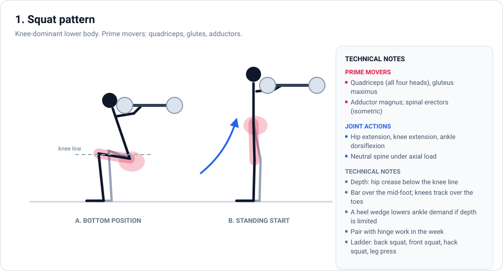

The six slots used here:

1. **Squat** (knee-dominant lower body)
2. **Hinge** (hip-dominant posterior chain)
3. **Horizontal push**
4. **Vertical push**
5. **Horizontal pull**
6. **Vertical pull**

Each pattern below gets a diagram, a prime-mover list, the joint actions involved, and a short ladder of exercise variations ordered roughly from most to least demanding. The ladders are not mandatory progressions. They exist so that a stalled exercise has somewhere to go without redesigning the week.

### 2.1 Squat

The squat is the knee-dominant lower-body pattern: hips and knees flex under axial load, then extend. It is the most efficient way to load the quadriceps through a long range while also training the glutes and adductors.

Prime movers: quadriceps (all four heads), gluteus maximus, adductor magnus. The spinal erectors and trunk work isometrically to keep the load over the midfoot. Ankle dorsiflexion range determines how upright the torso can stay, so a heel wedge or lifting shoe buys depth when ankle range is the limiter.

Depth is not cosmetic. The quadriceps reach their longest position near the bottom of a full squat, and cutting depth short removes the part of the range where the growth stimulus appears strongest (Wolf et al., 2025; Pedrosa et al., 2026). A practical target is the hip crease at or slightly below the knee line, with the bar over the midfoot and the knees tracking over the toes. Individual hip anatomy sets a natural bottom position; within that constraint, use the range you own.

**Default:** 3-4 sets of 4-8 reps at RIR 1-3 as the first lift of a lower-body session, or 2-3 sets of 8-15 when it follows a heavier hinge. Both progression styles work: add load when the top of the rep range is reached at the target effort, otherwise add reps (Plotkin et al., 2022).

**Ladder:** back squat, front squat, hack squat, leg press, split squat, goblet squat. Machines are legitimate substitutes here. Pooled comparisons show similar hypertrophy between free-weight and machine training when effort is matched (Haugen et al., 2023).

**Failure mode:** letting depth shrink as the bar gets heavier. If the bottom position creeps up over a training block, the load has outrun the range. Film a top set occasionally.

### 2.2 Hinge

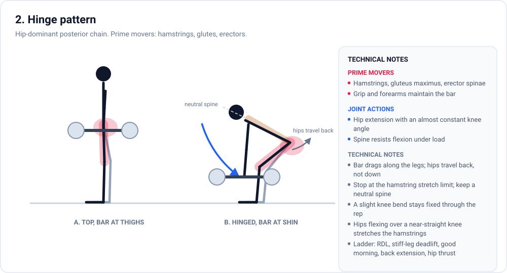

The hinge is the hip-dominant pattern: the knees stay nearly fixed while the hips travel backward, and the spine resists flexion under load. It is the main direct stimulus for the hamstrings, which squat-and-press routines tend to under-train, and it loads the glutes and spinal erectors heavily.

Prime movers: hamstrings, gluteus maximus, erector spinae. Grip and forearms limit the lift before the hamstrings do for many people, which makes straps a legitimate tool rather than a shortcut.

The bar drags along the legs, and the hips travel back rather than down. Stop where the hamstrings reach their stretch limit with the spine still neutral. A slight, constant knee bend keeps tension on the hamstrings. Letting the knees bend and straighten through the rep turns the movement into a lower-back exercise. The stretched position is the point of the exercise, so control the descent and do not bounce out of the bottom (Pedrosa et al., 2026).

**Default:** 2-4 sets of 5-10 reps at RIR 1-3 for a barbell hinge, or 2-3 sets of 8-12 for stiff-leg and single-leg variants. Heavy hinges are systemically expensive, so place them after the squat or on a separate day.

**Ladder:** Romanian deadlift, stiff-leg deadlift, good morning, back extension, cable pull-through, hip thrust. The hip thrust is a glute lift with the hamstrings short, so it complements a hinge rather than replacing it.

**Failure mode:** the bar drifting away from the legs, which shifts load to the lower back. Keep the bar in contact with the thigh and shin, and reset the set when contact is lost.

### 2.3 Horizontal push

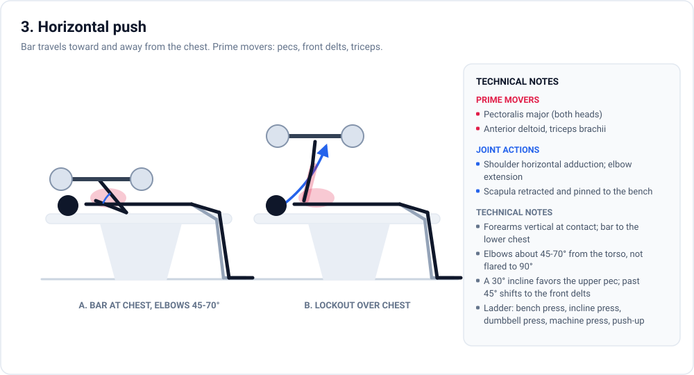

The bar travels toward and away from the chest. Prime movers: pectoralis major (both heads), anterior deltoid, triceps brachii. The scapulae stay retracted and pinned to the bench, and the forearms stay close to vertical at contact.

Bench angle changes which region of the chest receives the most stimulation. Electromyography favors about 30 degrees of incline for the upper pectoralis and a flat bench for the mid and lower regions. Inclines beyond 45 degrees hand the work to the front delts (Rodríguez-Ridao et al., 2020). Treat activation data as directional. It tells you where emphasis goes, not how much a region grows.

**Default:** 3-4 sets of 4-8 reps at RIR 1-3 as the first press of a session, or 2-3 sets of 8-15 as a secondary press in dumbbell or machine form. Elbows drift out of position when the load is too heavy. When they flare to 90 degrees, the shoulder takes over from the chest.

**Ladder:** bench press, incline press, dumbbell press, machine press, push-up. Fly variations cover the same joint action in isolation and can fill a few sets late in a session.

**Failure mode:** the bar drifting toward the neck and the elbows flaring wide, which turns a chest press into a shoulder press with worse mechanics.

### 2.4 Vertical push

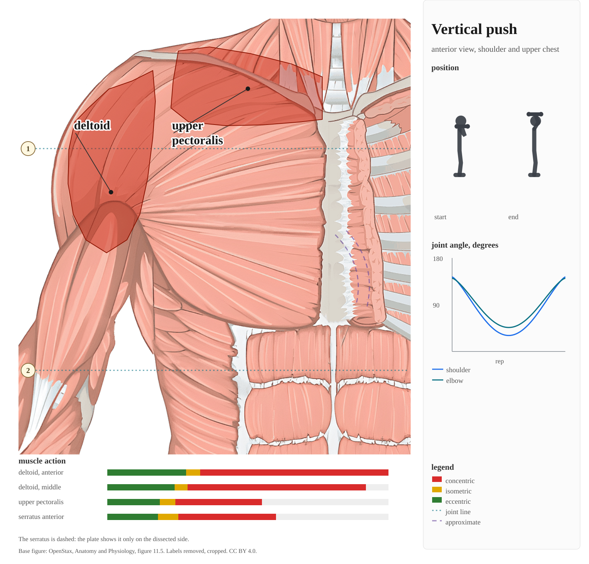

Pressing overhead. Prime movers: deltoids (anterior and middle heads), triceps brachii, upper pectoralis, serratus anterior. The joint actions are shoulder flexion and abduction with scapular upward rotation, which is why a healthy lockout involves the shoulder blades moving, not just the arms.

Keep the ribs down and the glutes braced. A press that starts with a backward lean turns into an incline press with a longer range, and the lower back absorbs the difference. At lockout the head moves through the window and the bar finishes over the midfoot.

**Default:** 2-4 sets of 5-10 reps at RIR 1-3 for a barbell press, or 2-3 sets of 8-15 for dumbbell and machine versions. If shoulders are a priority, add 2-3 sets of lateral raises. Abduction work covers the middle delts that pressing under-serves.

**Ladder:** standing barbell press, seated dumbbell press, machine press, landmine press, pike push-up.

**Failure mode:** leaning back to grind out reps. Ribs stay down or the set ends.

### 2.5 Horizontal pull

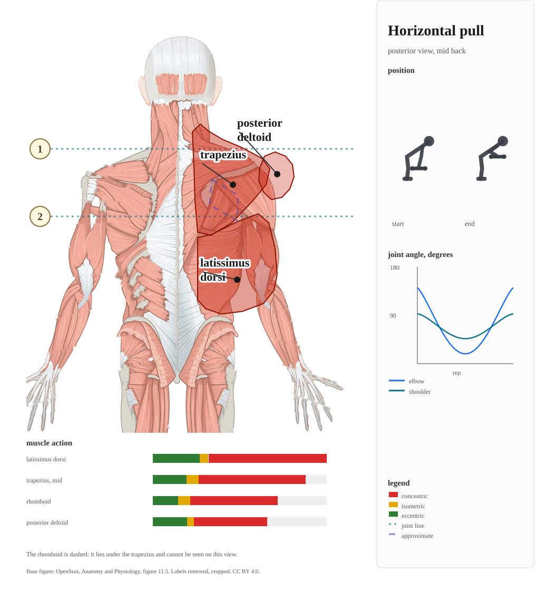

Pulling the load toward the torso. Prime movers: mid and lower trapezius, rhomboids, latissimus dorsi, rear deltoids, with the elbow flexors assisting. The joint actions are shoulder horizontal abduction and extension with scapular retraction.

The torso stays fixed and the bar arrives at the lower ribs, not the neck. Drive the elbows. The hands are hooks. Chest-supported versions cut spinal fatigue, which matters on days that already contain a hinge.

**Default:** 3-4 sets of 6-10 reps at RIR 1-2, or 2-3 sets of 8-15 for one-arm and cable versions. As a working rule for shoulder balance, keep weekly horizontal pulling sets at or above weekly horizontal pressing sets.

**Ladder:** barbell row, chest-supported row, cable row, one-arm dumbbell row, inverted row.

**Failure mode:** torso english. If the rep count climbs by swinging the spine, the last reps belong to the lower back, not the mid-back.

### 2.6 Vertical pull

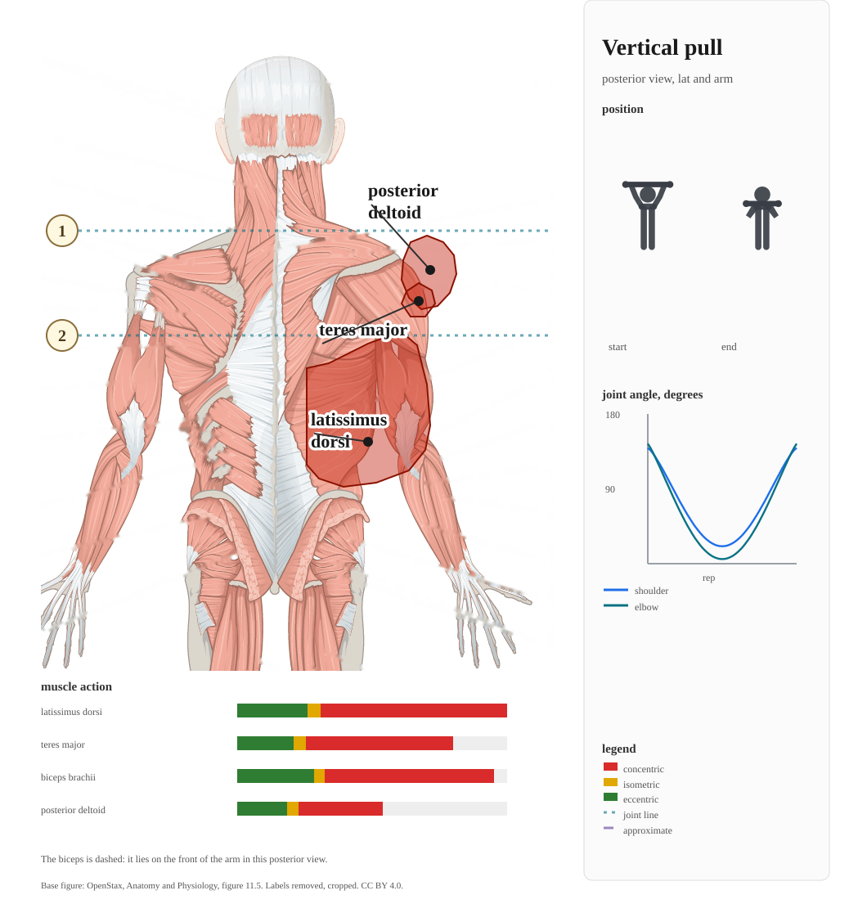

Pulling from overhead. Prime movers: latissimus dorsi, teres major, biceps brachii, brachialis, and the forearm flexors as grip. The joint actions are shoulder adduction and extension with scapular depression.

Drive the elbows down toward the ribs and bring the bar or handle to the upper chest, with a slight torso lean of roughly 10 to 15 degrees and no swinging. Start every rep from the overhead stretch. That long-length position is where the lats do the most work (Pedrosa et al., 2026).

**Default:** 3-4 sets of 6-10 reps at RIR 1-2 if you can handle bodyweight pull-ups, otherwise 3 sets of 8-15 on a pulldown. Add load when the top of the range is reached. Add reps otherwise.

**Ladder:** pull-up, chin-up, lat pulldown, one-arm pulldown.

**Failure mode:** half reps that start from bent arms. Cutting the overhead portion removes the most productive part of the range.

**Coverage audit.** Tag every exercise in a week with one of the six patterns and count the hard sets that land in each row. If something reads zero, either the muscle gets stimulus indirectly (rows and pulldowns cover a good share of the biceps) or a slot is genuinely missing. No pattern is mandatory on its own. The checklist exists to catch accidents.

## 3. Programming variables

The variables below interact, so change one at a time when diagnosing a problem. Volume and effort are the two that move outcomes most. The rest exist to protect their quality.

### 3.1 Weekly volume

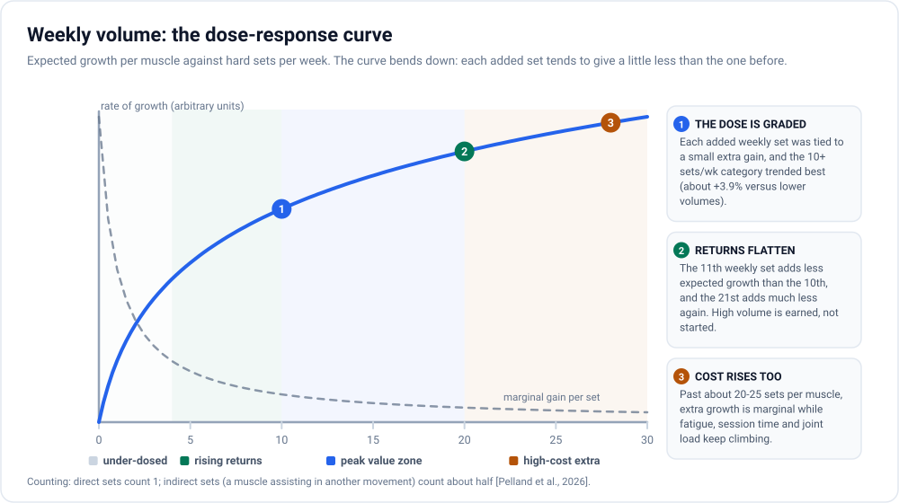

Counting rule: a direct hard set counts as one. Indirect work (triceps during pressing, biceps during rows) counts as about half a set (Pelland et al., 2026). Use that to total each muscle's week, including fractional contributions.

The dose-response is graded. In a pooled analysis, each additional weekly set was associated with a small increment in growth, roughly 0.4 percent per set, and the 10-plus sets category trended ahead of lower volumes (Schoenfeld et al., 2017). A later meta-regression with fractional counting reached the same shape: volume drives hypertrophy with diminishing returns (Pelland et al., 2026).

Roughly 10 to 20 hard sets per muscle per week is a defensible working range. Below 10, gains are typically leaving something on the table. Above 20 to 25, the extra sets mostly add fatigue, session time, and joint wear for a shrinking marginal return. The edges are soft and individual. Experienced lifters recover from more volume than beginners, and a muscle that receives junk indirect sets all week arrives at its direct work pre-fatigued.

Practical approach: start near the low end of the range for a muscle you are not prioritizing, put priority muscles at 15 to 20 sets, and add 2 to 4 sets per block rather than all at once. If recovery markers (performance, sleep, joints) decline, the volume was spent too fast.

### 3.2 Effort: proximity to failure

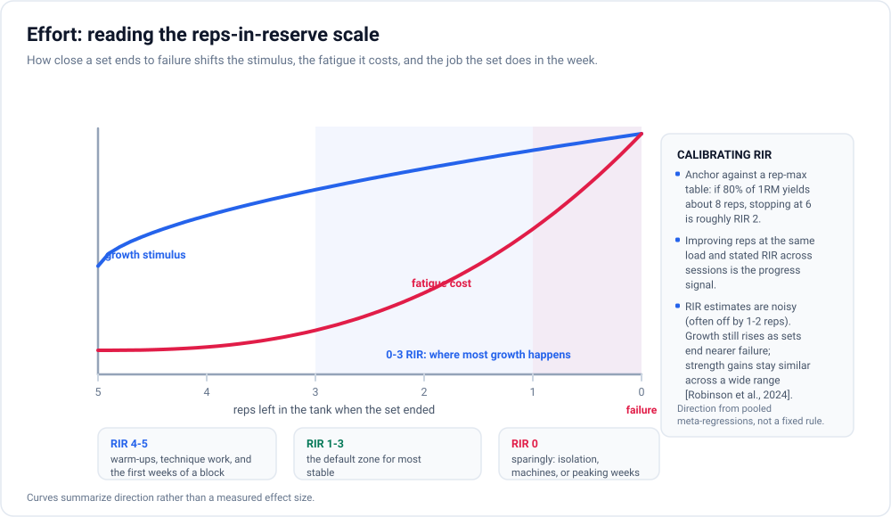

RIR (reps in reserve) is how close a set ends to failure: RIR 2 means two more reps were probably available. In meta-regressions across the literature, hypertrophy increased as sets ended closer to failure, while strength gains were far less sensitive to it across a wide range of efforts (Robinson et al., 2024). A controlled trial with fixed loads found the same direction: letting more reps happen before ending the set (more velocity loss) produced more quadriceps growth, at the cost of some jump performance (Pareja-Blanco et al., 2017).

Working defaults:

- Most working sets: RIR 1-3. This is where most of the growth sits for most people, with a fatigue cost that can still be recovered from session to session.
- Final sets of isolation or machine work: RIR 0-1 is fine. The systemic cost is low and the local stimulus is high.
- Heavy barbell compounds: avoid routine RIR 0. At true failure, form degrades first and the functional beatdown costs more than the marginal stimulus is worth.

Calibrate rather than guess. Anchor against a rep-max table (if 80 percent of your 1RM normally yields about 8 reps, stopping at 6 is roughly RIR 2), then track reps at a fixed load across sessions. RIR estimates are noisy, often off by 1 to 2 reps, and improve with deliberate practice. Absolute precision is not required, because the ranking that matters is simple: nearer failure, more growth. The last rep or two buy more than the first.

### 3.3 Frequency

Training each muscle at least twice per week is a practical default rather than a growth law. When weekly volume is equated, pooled data show no meaningful hypertrophy advantage for higher frequencies (Schoenfeld et al., 2016; Pelland et al., 2026). The case for frequency is that it spreads the same volume across more fresh sessions. Five sets of squats in one session and five across two both count, but the version across two sessions usually has better rep quality on sets three through five.

For a three-day week, a full-body split covers every pattern at least once. For four days, an upper/lower split shortens the sessions and spreads the volume further. A priority muscle can be trained a third time if it recovers.

### 3.4 Rest intervals

Rest is a quality-control variable. Very short rests (under about 60 seconds) modestly reduce hypertrophy compared with longer ones, while differences among rests beyond roughly 60 to 90 seconds are small (Singer et al., 2024). Heavy compound sets benefit from two to three minutes. Without it, the next set becomes a different, lighter exercise. Isolation work runs fine on 60 to 90 seconds.

One practical signal: if a set ended because you were out of breath rather than out of muscle, rest longer. The set was limited by the wrong system.

### 3.5 Range of motion and muscle length

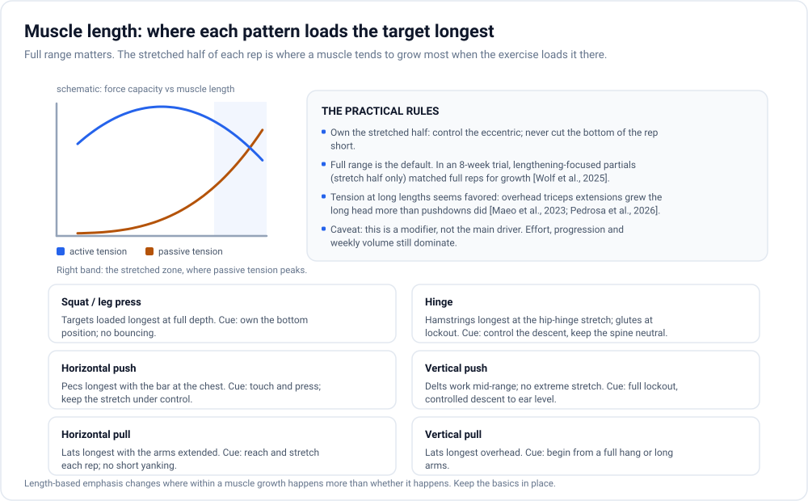

Full range with control is the default for every exercise in this document. The refinement on top of that is an emphasis on the stretched end of the range.

The evidence for that emphasis:

- In a trial with trained lifters, "lengthened partial" reps over the stretch half of the movement produced similar muscle growth to full-range reps over eight weeks (Wolf et al., 2025). Partials are a tool rather than cheating, and the stretch side is the side that carries the result.
- Reviewing the muscle-length literature, Pedrosa et al. (2026) concluded that training a muscle closer to its long lengths appears to favor growth when the exercise applies real tension in that position.
- The clearest single comparison comes from the triceps: overhead cable extensions, where the long head sits stretched, grew the long head substantially more than pushdowns, where it sits short, under otherwise matched training (Maeo et al., 2023).

Practical application is mostly exercise choice, and section 2 carries the per-pattern cues. The short version: pick variations that load the target in its stretched position (incline pressing for the upper chest, overhead extensions for the long head of the triceps, deep squats for the quadriceps), do not cut the bottom of the rep short to chase load, and control the eccentric instead of dropping through it. Lengthened partials near the end of a set are a legitimate way to extend local fatigue.

One caveat: length emphasis changes where growth happens more than whether it happens. Effort, volume, and progression still dominate the outcome. Do not trade a heavy set for a fancy one.

### 3.6 Exercise selection and variation

Patterns are the slots. Exercises fill them. Choose one or two exercises per pattern per block. Larger menus than that usually cost more in trackability than they buy in stimulus, because the exercise is the unit you log and progress. Swapping it resets the comparison.

The evidence on rotating exercises is more supportive than the internet usually assumes:

- In one 12-week study, lifters who rotated exercises gained more strength and developed the quadriceps more uniformly across all four heads than lifters who repeated the same movements (Fonseca et al., 2014).
- A systematic review of exercise variation found that exchanging exercises across a training cycle does not hurt hypertrophy and can support regional growth, while rotating so often that progression becomes impossible to judge is where variation starts to cost (Kassiano et al., 2022).

Practical rules:

- Keep the main lift for each pattern stable long enough to track progression, roughly 6 to 12 weeks.
- Rotate when a lift stalls despite recovery being in order (section 5), or one slot at a time at block boundaries.
- Expect a learning cost. Any new exercise underperforms for a few sessions while the skill builds, so do not panic-rotate when a first exposure looks weak.
- Free weights and machines produce similar hypertrophy when effort and volume are matched. Strength gains are specific to the modality trained. Pick on stability, joint comfort, and how effectively you can push effort (Haugen et al., 2023).

The variation trap is rotating everything constantly. That feels fresh and makes progress unmeasurable. The value of variation is coverage of angles and tissue, not novelty for its own sake.

## 4. Anatomy of a session

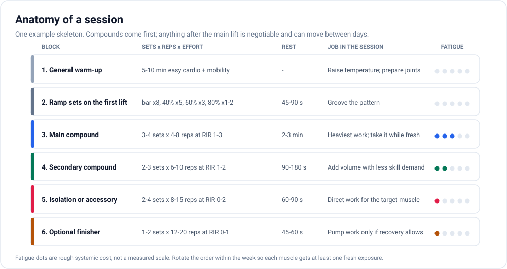

Sessions have a standard skeleton. The order is not sacred, but it is not random either: attention and recovery are finite, so the pattern you care about most that day gets the first hard sets, while they are the best sets you will do.

A few mechanics worth making explicit:

- **Ramp sets do not count as hard sets.** They practice the pattern and rehearse the load. The weekly volume totals in section 3.1 begin with the first set taken close to failure.
- **Session size:** four to seven exercises, which usually lands around 60 to 90 minutes including rest. If sessions regularly run past that, the routine has more exercise slots than it has quality to fill, and trimming one or two accessories costs less than it looks.
- **Per-session volume per muscle:** roughly 2 to 6 hard sets, which is what the weekly band implies once volume is spread across two or three sessions. Ten sets in one session for a single muscle is not forbidden, but the last five are usually worse sets than the same five placed earlier in the week.
- **Order later in the session is negotiable.** Isolation work for a priority muscle can move ahead of a secondary compound if the priority needs the freshness. Supersets are fine for saving time on accessory work. Pairing heavy compounds back to back usually degrades the second one.

## 5. Progression, stalls and rotation

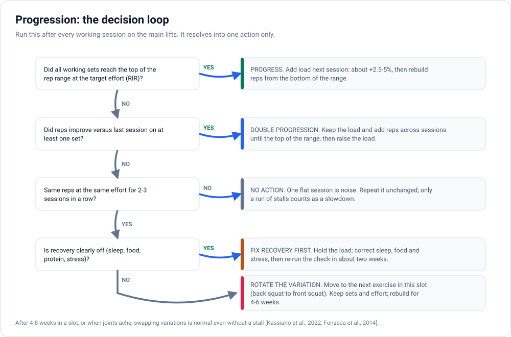

Progression is the engine, and for hypertrophy it can be boring on purpose. Two mechanisms matter, and they are not in conflict:

1. **Double progression in a rep range.** Choose a range for the exercise (for example 5 to 8 reps). Start at the bottom of the range with the target effort. Add reps at the same load across sessions until every set reaches the top of the range at the target RIR, then add the smallest load jump available and drop back to the bottom of the range.
2. **Load progression directly.** When the smallest jump still leaves you below the rep range with room in reserve, add load and let the reps rebuild. Load and rep progression produce similar hypertrophy over a block (Plotkin et al., 2022), so pick whichever keeps the log honest.

Two rules keep the log honest. A rep gained with visibly degraded form is not a rep; it returns next session as a debt. And progress is judged over weeks, not sessions. Strength moves in waves within a block, and a flat week mid-block is normal even when everything is working.

**What counts as a stall.** No rep improvement on a lift at the same load and effort for two or three consecutive sessions. One flat session is noise and gets repeated unchanged. Three flat sessions in a row is information, and it triggers the sequence below in order:

1. **Audit recovery before changing the program.** Sleep, calories, protein (about 1.6 g/kg per day covers most people, with data allowing up to roughly 2.2 g/kg per day in some cases; Morton et al., 2018), and stress. Most stalls live here.
2. **Check the volume for that muscle** against the 10 to 20 set band. Six weekly sets for a stalled muscle may be too little. Twenty-five may be spending recovery on junk.
3. **Rotate the variation** in that pattern slot (section 3.6). Same pattern, same effort target, new exercise, usually keeping the rep range.
4. **Deload** if performance has declined across multiple lifts, joints ache, or sleep and mood are sliding. Section 6 covers how.

## 6. Periodization and deloads

For hypertrophy, elaborate periodization models are optional. Over 24 weeks, lifters who alternated training and rest blocks ended with the same muscle size and strength as lifters who trained continuously, and the periodic group retrained faster after breaks (Ogasawara et al., 2013). The practical reading: block structure is a tool for managing fatigue and motivation, not a secret stimulus. Run productive training until performance and joints ask for a break.

A block that works: six to ten weeks of double progression (section 5), then one deload week, then repeat, usually with one variation swap somewhere in the next block.

**What a deload should be:**

- **Reduced volume, not a week off.** In a supervised trial, taking a full week off training mid-block did not improve hypertrophy and slightly reduced strength gains compared with training through (Coleman et al., 2024). A week out of the gym is survivable, but it is not the efficient move.
- **Still recognizable training.** Keep the exercises and roughly the effort targets, cut sets by about 40 to 60 percent, and optionally cap loads around 70 to 80 percent of normal working weights. The international deloading consensus landed on volume reduction with maintenance of some loading, taken routinely rather than only after breakdown (Bell et al., 2023).
- **Triggered, not ritualized.** Given that periodic breaks did not out-perform continuous training (Ogasawara et al., 2013), the honest schedule is risk-based: deload when performance slides across multiple lifts, joints ache, or sleep and mood dip alongside training stress.

## 7. A worked example week

An illustration of how the pieces fit together, not a prescription. Three full-body days is the minimum viable schedule that covers all six patterns with a life attached. The per-muscle volumes land at the low end of the working band on purpose, and the counting rules in section 3.1 can be used to raise whatever is a priority.

| Day | Pattern | Exercise | Sets x Reps | Target RIR |
|---|---|---|---|---|
| A | Squat | Back squat | 4 x 5-8 | 1-2 |
| A | Horizontal push | Bench press | 3 x 5-8 | 1-2 |
| A | Horizontal pull | Chest-supported row | 3 x 8-12 | 1-2 |
| A | Hinge | Romanian deadlift | 2 x 8-10 | 2 |
| A | Accessory (side delts) | Lateral raise | 2 x 12-15 | 0-1 |
| B | Vertical pull | Pull-up or lat pulldown | 3 x 6-10 | 1-2 |
| B | Vertical push | Seated dumbbell press | 3 x 6-10 | 1-2 |
| B | Squat | Leg press | 3 x 8-12 | 1-2 |
| B | Hinge accessory | Seated leg curl | 2 x 10-12 | 0-1 |
| B | Squat accessory | Leg extension | 2 x 10-15 | 0-1 |
| B | Accessory (elbow flexors) | Incline curl | 2 x 10-15 | 0-1 |
| C | Hinge | Trap-bar deadlift | 3 x 5-8 | 1-2 |
| C | Horizontal pull | One-arm dumbbell row | 3 x 8-12 | 1-2 |
| C | Horizontal push | Incline dumbbell press | 3 x 8-12 | 1-2 |
| C | Accessory (triceps) | Overhead cable extension | 2 x 10-15 | 0-1 |
| C | Accessory (side delts) | Lateral raise | 2 x 12-15 | 0-1 |

Spacing: leave roughly 48 hours between sessions that share heavy patterns, which makes Monday, Wednesday, Friday the natural layout. Comparable exercises can be substituted freely. What must survive substitution is the pattern, the rep range, and the effort target.

**Volume audit for the week above**, using the counting rules from section 3.1 (a direct set counts 1, an assisting muscle counts 0.5):

| Muscle | Direct sets | Half-credit | Effective total |
|---|---|---|---|
| Quadriceps | 9 (squat 4, leg press 3, leg extension 2) | 0 | 9 |
| Hamstrings | 7 (Romanian deadlift 2, trap-bar 3, leg curl 2) | 0 | 7 |
| Chest | 6 (bench 3, incline 3) | 0 | 6 |
| Back and lats | 9 (rows 6, pulldown or pull-up 3) | 0 | 9 |
| Side delts | 4 (laterals) | 3 (pressing 6 sets at 0.5) | 7 |
| Triceps | 2 (overhead extension) | 4.5 (bench 3, dumbbell press 3, incline 3 at 0.5) | 6.5 |
| Biceps | 2 (incline curl) | 4.5 (rows 6, pull-up 3 at 0.5) | 6.5 |

Every muscle lands between 6 and 9 effective sets, which is the honest shape of a three-day week: clearly productive, and under the 10 to 20 band that a dedicated priority would push toward. To raise a muscle, add its direct work first (two more squat sets and a second leg-extension set would move quadriceps from 9 toward 13), and place it earlier in its session (section 4).

## 8. Logging what matters

The log exists to support two decisions: what load goes on the bar next session, and whether a stall is real. Everything else is decoration.

Minimum per working set: exercise, load, reps completed, and RIR (at least for the last set of the exercise). "100 kg x 8 at RIR 2" is a decision-ready fact. "Felt heavy" is not.

Minimum per session: date, body weight (packing a weekly average is enough), and a short note for anything that explains an off day: poor sleep, a pinched shoulder, a rushed session. Two or three words is plenty.

Once a week, roll up:

- Hard sets per muscle, using the fractional counting rules from section 3.1.
- Any lift that meets the stall definition from section 5.
- Body weight trend, because it reframes strength stalls: flat performance while losing weight is expected. The same flat performance at stable weight is a different signal.

A workable spreadsheet shape: Date | Exercise | Load | Reps per set | RIR (last set) | Notes, backed by a weekly summary tab: Week | Body weight (average) | Sessions completed | Sets per muscle | Stalls flagged. Skip estimated-1RM tables while form is still changing. The honest unit is reps at a stated load and effort.

## 9. Limits of this analysis

- **Population and duration.** Most of the cited trials studied healthy, younger, trained or semi-trained adults over six weeks to six months. Extrapolating to decades, to older or clinical populations, or to advanced competitors is reasonable inference, not evidence.
- **Measurement.** Hypertrophy was measured mostly by imaging specific muscles, with real measurement error. Single small trials are noisy. The load-bearing claims here rest on meta-analyses and reviews wherever possible. Electromyography describes activation, not growth, so it appears only where the question is emphasis (bench angle), with the caveat stated.
- **The numbers are central tendencies.** Ten to twenty sets, RIR 1-3, two to three sessions per muscle per week, six to ten week blocks: these are default settings for a typical lifter, and individual response varies with age, training history, joint health, sleep, energy intake, and genetics. The only reliable way to find personal thresholds is to log and adjust (section 8).
- **Out of scope.** Nutrition beyond protein sufficiency, injury rehabilitation, medical conditions, pharmacology, conditioning work, and adherence psychology each deserve their own document.
- **Terminology.** Where a claim is written as "trended" or "appears," treat it as directional support, not settled fact. Where it is written flatly, multiple meta-analyses agree.
- **Currency.** Last updated October 2026. Training science moves. Re-verify against the primary sources before building on this.

## References

1. Bell, L., Strafford, B. W., Coleman, M., Androulakis Korakakis, P., & Nolan, D. (2023). Integrating deloading into strength and physique sports training programmes: An international Delphi consensus approach. *Sports Medicine - Open*, 9, 87. https://doi.org/10.1186/s40798-023-00633-0
2. Coleman, M., Burke, R., Augustin, F., Piñero, A., Maldonado, J., Fisher, J. P., Israetel, M., Androulakis Korakakis, P., Swinton, P., Oberlin, D., & Schoenfeld, B. J. (2024). Gaining more from doing less? The effects of a one-week deload period during supervised resistance training on muscular adaptations. *PeerJ*, 12, e16777. https://doi.org/10.7717/peerj.16777
3. Fonseca, R. M., Roschel, H., Tricoli, V., de Souza, E. O., Wilson, J. M., Laurentino, G. C., Aihara, A. Y., de Souza Leão, A. R., & Ugrinowitsch, C. (2014). Changes in exercises are more effective than in loading schemes to improve muscle strength. *Journal of Strength and Conditioning Research*, 28(11), 3085-3092. https://doi.org/10.1519/JSC.0000000000000539
4. Haugen, M. E., Vårvik, F. T., Larsen, S., Haugen, A. S., van den Tillaar, R., & Bjørnsen, T. (2023). Effect of free-weight vs. machine-based strength training on maximal strength, hypertrophy and jump performance: A systematic review and meta-analysis. *BMC Sports Science, Medicine and Rehabilitation*, 15, 103. https://doi.org/10.1186/s13102-023-00713-4
5. Kassiano, W., Nunes, J. P., Costa, B., Ribeiro, A. S., Schoenfeld, B. J., & Cyrino, E. S. (2022). Does varying resistance exercises promote superior muscle hypertrophy and strength gains? A systematic review. *Journal of Strength and Conditioning Research*, 36(6), 1753-1762. https://doi.org/10.1519/JSC.0000000000004258
6. Maeo, S., Wu, Y., Huang, M., Sakurai, H., Kusagawa, Y., Sugiyama, T., Kanehisa, H., & Isaka, T. (2023). Triceps brachii hypertrophy is substantially greater after elbow extension training performed in the overhead versus neutral arm position. *European Journal of Sport Science*, 23(7), 1240-1250. https://doi.org/10.1080/17461391.2022.2100279
7. Morton, R. W., Oikawa, S. Y., Wavell, C. G., Mazara, N., McGlory, C., Quadrilatero, J., Baechler, B. L., Baker, S. K., & Phillips, S. M. (2016). Neither load nor systemic hormones determine resistance training-mediated hypertrophy or strength gains in resistance-trained young men. *Journal of Applied Physiology*, 121(1), 129-138. https://doi.org/10.1152/japplphysiol.00154.2016
8. Morton, R. W., Murphy, K. T., McKellar, S. R., Schoenfeld, B. J., Henselmans, M., Helms, E., Aragon, A. A., Devries, M. C., Banfield, L., Krieger, J. W., & Phillips, S. M. (2018). A systematic review, meta-analysis and meta-regression of the effect of protein supplementation on resistance training-induced gains in muscle mass and strength in healthy adults. *British Journal of Sports Medicine*, 52(6), 376-384. https://doi.org/10.1136/bjsports-2017-097608
9. Ogasawara, R., Yasuda, T., Ishii, N., & Abe, T. (2013). Comparison of muscle hypertrophy following 6-month of continuous and periodic strength training. *European Journal of Applied Physiology*, 113(4), 975-985. https://doi.org/10.1007/s00421-012-2511-9
10. Pareja-Blanco, F., Rodríguez-Rosell, D., Sánchez-Medina, L., Sanchis-Moysi, J., Dorado, C., Mora-Custodio, R., Yáñez-García, J. M., Morales-Alamo, D., Pérez-Suárez, I., Calbet, J. A. L., & González-Badillo, J. J. (2017). Effects of velocity loss during resistance training on athletic performance, strength gains and muscle adaptations. *Scandinavian Journal of Medicine & Science in Sports*, 27(7), 724-735. https://doi.org/10.1111/sms.12678
11. Pedrosa, G. F., Pereira, M. R., & Kassiano, W. (2026). The interplay between muscle length, range of motion, and exercise selection: A review. *Sports Medicine International Open*, 10, a27337605. https://doi.org/10.1055/a-2733-7605
12. Pelland, J. C., Remmert, J. F., Robinson, Z. P., Hinson, S. R., & Zourdos, M. C. (2026). The resistance training dose response: Meta-regressions exploring the effects of weekly volume and frequency on muscle hypertrophy and strength gains. *Sports Medicine*, 56(2), 481-505. https://doi.org/10.1007/s40279-025-02344-w
13. Plotkin, D., Coleman, M., Van Every, D., Maldonado, J., Oberlin, D., Israetel, M., Feather, J., Alto, A., Vigotsky, A. D., & Schoenfeld, B. J. (2022). Progressive overload without progressing load? The effects of load or repetition progression on muscular adaptations. *PeerJ*, 10, e14142. https://doi.org/10.7717/peerj.14142
14. Robinson, Z. P., Pelland, J. C., Remmert, J. F., Refalo, M. C., Jukic, I., Steele, J., & Zourdos, M. C. (2024). Exploring the dose-response relationship between estimated resistance training proximity to failure, strength gain, and muscle hypertrophy: A series of meta-regressions. *Sports Medicine*, 54(9), 2209-2231. https://doi.org/10.1007/s40279-024-02069-2
15. Rodríguez-Ridao, D., Antequera-Vique, J. A., Martín-Fuentes, I., & Muyor, J. M. (2020). Effect of five bench inclinations on the electromyographic activity of the pectoralis major, anterior deltoid, and triceps brachii during the bench press exercise. *International Journal of Environmental Research and Public Health*, 17(19), 7339. https://doi.org/10.3390/ijerph17197339
16. Schoenfeld, B. J., Ogborn, D., & Krieger, J. W. (2016). Effects of resistance training frequency on measures of muscle hypertrophy: A systematic review and meta-analysis. *Sports Medicine*, 46(11), 1689-1697. https://doi.org/10.1007/s40279-016-0543-8
17. Schoenfeld, B. J., Ogborn, D., & Krieger, J. W. (2017). Dose-response relationship between weekly resistance training volume and increases in muscle mass: A systematic review and meta-analysis. *Journal of Sports Sciences*, 35(11), 1073-1082. https://doi.org/10.1080/02640414.2016.1210197
18. Singer, A., Wolf, M., Generoso, L., Arias, E., Delcastillo, K., Echevarria, E., Martinez, A., Androulakis Korakakis, P., Refalo, M. C., Swinton, P. A., & Schoenfeld, B. J. (2024). Give it a rest: A systematic review with Bayesian meta-analysis on the effect of inter-set rest interval duration on muscle hypertrophy. *Frontiers in Sports and Active Living*, 6, 1429789. https://doi.org/10.3389/fspor.2024.1429789
19. Škarabot, J., Brownstein, C. G., Casolo, A., Del Vecchio, A., & Ansdell, P. (2021). The knowns and unknowns of neural adaptations to resistance training. *European Journal of Applied Physiology*, 121(3), 675-685. https://doi.org/10.1007/s00421-020-04567-3
20. Wolf, M., Androulakis Korakakis, P., Piñero, A., Mohan, A. E., Hermann, T., Augustin, F., Sapuppo, M., Lin, B., Coleman, M., Burke, R., Nippard, J., Swinton, P. A., & Schoenfeld, B. J. (2025). Lengthened partial repetitions elicit similar muscular adaptations as full range of motion repetitions during resistance training in trained individuals. *PeerJ*, 13, e18904. https://doi.org/10.7717/peerj.18904

---

Text and figures in this repository are original work, released under the [CC BY 4.0](LICENSE) license. This is general information, not medical advice. Consult a qualified professional for personal guidance.

